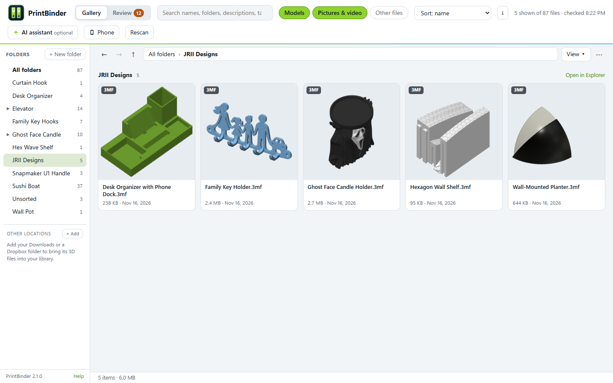
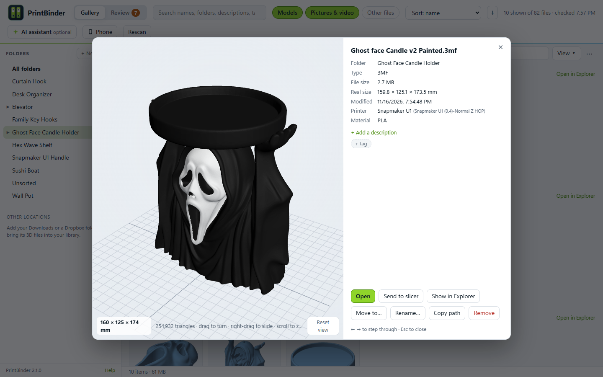
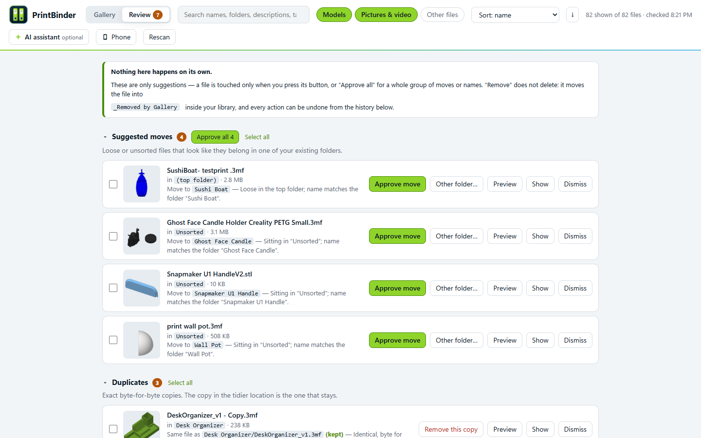
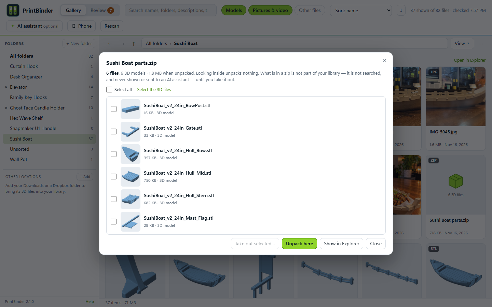
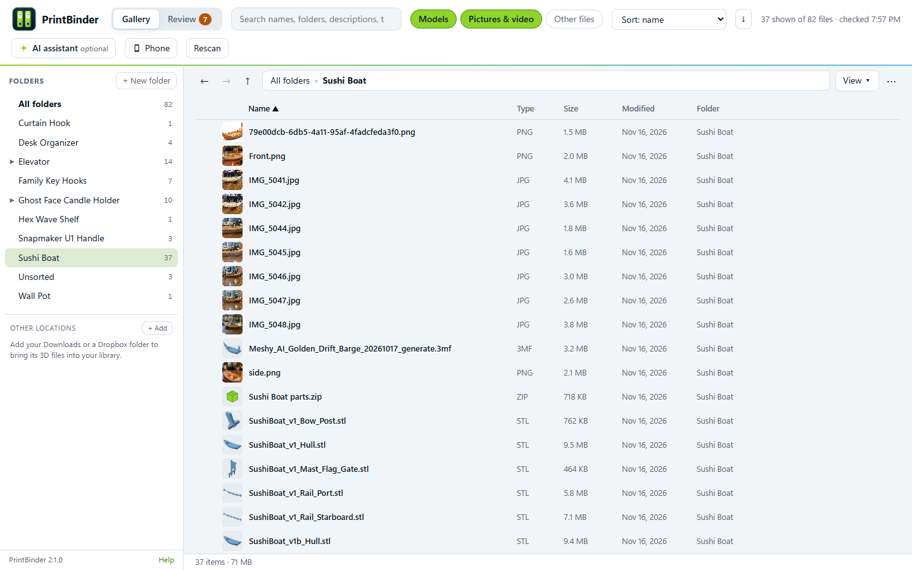

# PrintBinder

**by JRII Designs**

PrintBinder is a free Windows program for browsing and organising a 3D-printing library. It shows every model you have with a preview picture, opens models in a 3D viewer, and helps you bring files scattered over folders and drives into one tidy library. It never moves, renames or removes anything you have not approved, and everything it does can be undone.

It works on the folders you already have. There is no account, no sign-in and no telemetry.

PrintBinder was called Print Gallery up to version 2.0.2. Updating from Print Gallery keeps everything: see [Coming from Print Gallery](#coming-from-print-gallery).

## Screenshots



*The gallery: a folder of models with preview pictures, and the folder list on the left.*



*A model open in the 3D viewer with its measured size.*



*Review: suggested moves and duplicates waiting for approval.*



*A zip file opened to show what is inside, without unpacking.*



*The Details list with sortable columns.*

## Installing

1. Download `PrintBinder-Setup-<version>.exe` from the Releases page and run it.
2. **Windows will warn you.** The installer is not code-signed yet, so Windows SmartScreen shows "Windows protected your PC" with an unknown publisher. Choose **More info**, then **Run anyway**. Your browser may also ask whether to keep the download; choose **Keep**.
3. The setup wizard installs PrintBinder for your Windows account only. No administrator password is needed. It adds a desktop and a Start-menu shortcut.
4. On first start PrintBinder asks for your **home folder**: the folder your 3D files live in, or an empty folder to start a library. It can be an ordinary folder or one inside Google Drive, Dropbox or OneDrive. Installing changes nothing in your folders.

To update later, use **Help > Check for updates**. PrintBinder also looks quietly at start and shows a notice when a newer version exists. It installs only when you press the button, then reopens by itself and says which version it now is.

To uninstall, use Windows **Settings > Apps**. Your library is never touched. Your settings on the computer are kept unless you tick the box that removes them.

Requirements: Windows 10 or 11, 64-bit.

## The rules it keeps

- **Nothing moves until you say so.** Every suggestion waits in Review for your approval.
- **Remove never deletes.** A removed file goes to the folder `_Removed by Gallery` inside its library.
- **Everything can be undone** (Ctrl+Z, or the history in Review) and redone (Ctrl+Y).
- **Moves between drives are verified**: copied, compared byte for byte, and only then removed from where they were.
- **An out-of-date copy only looks.** When several computers share a library and a newer version has worked on it, an older copy opens look-only until it is updated.
- **The AI features are optional.** Nothing is sent to an AI service unless you entered a key and pressed a button or sent a message, and then only preview pictures, names and descriptions. Model files are never sent.

## What it does

- **Gallery.** Previews for STL, 3MF, OBJ and STEP files, pictures and videos. Picture sizes from small to extra large, a Details list with sortable columns, folders as tiles or everything under headings, search, and an address bar with Back, Forward and Up. Large libraries open and scroll quickly.
- **Works like Explorer.** Right-click menus, cut, copy and paste, drag and drop (including files dropped in from Explorer), drag a box to select, F2 to rename, Delete to remove, and a Replace / Keep both / Skip choice on a name clash. Drag a file's type badge out of the window to copy it to the desktop, an Explorer folder or a slicer.
- **3D viewer.** Opening a model shows it in 3D with its measured size.
- **Review.** Exact duplicates, files that cannot be read, and suggested moves and names, each approved one at a time, by group, or by ticking several. The built-in suggestions work from the folders your library already has, and stay quiet when nothing fits.
- **Zip files.** A zip shows as a package with a count of the 3D files inside. Open it to see its contents with previews without unpacking anything. Take out the files you choose (they keep the folders they have inside the zip) or unpack it all into a folder beside it. Every file taken out is checked against the zip's own checksum, and unpacking can be undone.
- **Send to slicer.** Set up your slicers once (PrintBinder finds the common ones) and send a model to any of them.
- **Other locations.** Show Downloads, another drive or a cloud folder beside the home library and bring their files home.
- **USB drives.** Plugging one in offers to copy or move its 3D files into the library.
- **Hidden folders.** Leave a folder out of the gallery, search, Review and everything an assistant is shown.
- **AI assistants (optional).** Claude, ChatGPT or Gemini, with your own API key.
- **Phone access (optional; home network only, not encrypted).** Pair a phone or tablet on the same home network with a one-time code and use your library from its browser. Off until you switch it on.
- **Help inside the program.** A guide, every keyboard shortcut, what is new, and a privacy statement, all under Help.

## AI keys

The AI features need an API key from the company that makes the assistant: Anthropic for Claude, OpenAI for ChatGPT, Google for Gemini. Open the assistant panel (Ctrl+K), paste a key, and choose which model describes pictures and which one sorts, plans and chats.

Each AI company bills its own key for what its assistant does, and a chat subscription (the ChatGPT, Claude or Gemini apps) does not include this.

With a key, an assistant can describe each preview picture so search finds things whatever the file is called, suggest clearer names, suggest where files belong, propose a tidier folder structure, split a catch-all folder, and answer questions about your library. Everything it proposes goes to Review and waits for your approval.

A key is entered on the computer itself, stored there encrypted by Windows for your user account, and never shown again, never put in the library folder and never given to a paired phone. Without a key, none of the AI features appear and nothing else changes.

## Privacy

- **Your files stay on your computer.** PrintBinder has no account and no server of its own. It collects nothing about you or your library and sends no usage figures or crash reports.
- **AI features** send something only if you entered a key, and only when you press a button or send a message. The request goes straight from your computer to the company whose key you entered. It can hold preview pictures, file and folder names, descriptions and tags, facts read from your files, and what you type. Model files are never sent. Hidden folders and the contents of zip files are never shown or sent.
- **Looking for an update** asks the place the releases are published whether there is a newer version. The request says nothing about you or your library.
- **Phone access** is off until you switch it on. It works inside your home network only and is **not encrypted**, so use it only on a network you trust, never on public Wi-Fi. Only devices you paired with a one-time code can connect.

The full statement is in the program under **Help > Privacy**.

## What is kept where

| Kept | Where | Why |
|---|---|---|
| Previews, descriptions, tags, the Review list, history | `<home folder>\PrintBinder\data` | Travels with the library, so every computer sharing the folder sees the same thing |
| Removed files | `<home folder>\_Removed by Gallery` | Remove never deletes |
| Home-folder choice, other locations, slicers, paired phones, AI keys, window layout | `%APPDATA%\PrintBinder` on each computer | Different on every computer; keys are encrypted by Windows and never leave it |

### Coming from Print Gallery

Running the PrintBinder installer on a computer that has Print Gallery turns that install into PrintBinder with nothing else to do. Nothing is moved or copied, so nothing can be lost:

- A library that was used with Print Gallery keeps its data folder under the old name, `<home folder>\Print Gallery\data`. PrintBinder uses it as it is. Leave it where it is.
- A computer that had Print Gallery keeps its settings folder under the old name, `%APPDATA%\Print Gallery`, with the saved AI keys, slicers, paired phones and other locations.
- The desktop and Start-menu shortcuts are replaced by ones named PrintBinder.

## Building from source

Needs Windows and a current Node.js (it is built with Node 24).

```
npm install
npm start          run from source
npm run dist       build the installer into dist\
```

`npm run dist` writes `dist\PrintBinder-Setup-<version>.exe`. `npm run dist:test` builds "PrintBinder Test", which installs beside the real program for trying an install, an update and an uninstall. `npm run art` redraws the icon and the installer pictures, and `npm run notices` rewrites `THIRD-PARTY-NOTICES.txt`.

| File | What it is |
|---|---|
| `brand.js` | The one place for the program's name, maker, addresses and update source |
| `main.js`, `preload.js` | The desktop window, menus, About, updates |
| `server.js` | The local server behind the page: scanning, previews, moving, history. Listens on 127.0.0.1 only |
| `folders.js` | Decides whether a chosen home folder or location is too broad (a whole drive, a whole user folder), and words the warning |
| `desk.js` | Slicers and plugged-in drives |
| `phone.js` | Phone access: the second listener, pairing, paired devices |
| `ai.js`, `providers/` | The AI features and the three assistants |
| `update.js` | Finding and fetching a newer version |
| `worker.js` | Renders preview pictures |
| `zip.js` | Reads zip files: what is inside, and taking files out with a checksum check |
| `public/index.html` | The whole page |
| `build/` | The setup wizard: its settings, wording and pictures |
| `scripts/` | Drawing the icon and installer pictures; writing the third-party notices; `latest.json` after a build |
| `docs/RELEASING.md` | The exact steps of a release |
| `docs/RENAMING.md` | How the name change from Print Gallery was done, and how to do another |

The in-app update check reads the releases of the GitHub project named in `brand.js` (`updateRepo`, at present `JRIIDesigns/printbinder`).

## Licence and credits

PrintBinder is open source under the [MIT licence](LICENSE).

Copyright (c) 2026 JRII Designs

You may use, change and share it, as long as the copyright line and the licence text stay with it. It comes with no warranty.

PrintBinder is built with Electron, three.js, occt-import-js, heic-decode and qrcode-generator. It talks to Anthropic, OpenAI and Google with plain HTTPS requests of its own, without their SDKs. Their licences are in [THIRD-PARTY-NOTICES.txt](THIRD-PARTY-NOTICES.txt), and in the program under Help > Third-party notices.

Claude, ChatGPT and Gemini are products of Anthropic, OpenAI and Google. Slicer names belong to their makers. PrintBinder is not affiliated with or endorsed by any of them.
